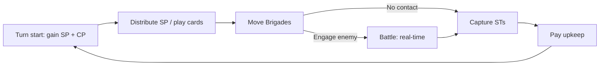

# Vision

## Summary
A simple-looking game that mixes turn-based grand strategy with real-time tactical shooting. The player leads a [[glossary#Faction|Faction]] in an alternate-history WW1, moving [[glossary#Brigade|Brigades]] across a campaign map like a board game. Whenever a battle starts, play switches to a real-time strategy / third-person shooter.

## Core loop

## Rules
- **VIS-001** (`decided`): The game MUST have two layers: a turn-based campaign layer and a real-time battle layer.
- **VIS-002** (`decided`): The campaign layer MUST play like a turn-based board game until a battle starts.
- **VIS-003** (`decided`): A battle MUST be played as a real-time strategy / third-person shooter hybrid (see [[player-character]], [[commands]]).
- **VIS-004** (`decided`): The player MUST lead a Faction that controls several Brigades.
- **VIS-005** (`decided`): Campaign goals MUST be to capture Strategic Targets (STs) and engage the enemy.
- **VIS-006** (`decided`): The presentation SHOULD look simple.

## Design pillars
1. **Logistics matter.** Supply decides how far you can go and how well you fight ([[supply]]).
2. **Specialise to win.** Brigades of similar units are rewarded ([[brigades]]).
3. **Commanders with stories.** Officers and heroes grow, get wounded and can die ([[officers]], [[aro-progression]]).
4. **Simple orders, real decisions.** A small command set, deliberately limited ([[commands]]).
5. **Asymmetric factions.** A shared core plus distinct faction flavour ([[factions-overview]]).

## Out of scope
- Detailed unit lists, cards, vehicles and map design: see their own notes.
