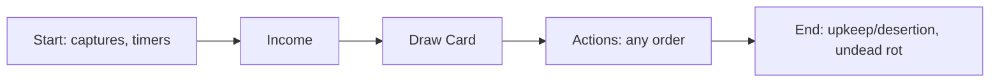

# Turn structure

## Summary
How a campaign turn flows. Players take alternating turns; each turn runs through the phases below.

## Rules
- **TRN-001** (`decided`): Each turn, a Faction MUST receive SP and CP income (see [[resources]]).
- **TRN-002** (`decided`): During a turn, a player MAY distribute SP from the reserve to Brigades, form Brigades, play Cards and move Brigades.
- **TRN-003** (`decided`): Moving a Brigade into contact with an enemy MUST start a battle (see [[battle-initiation]]).
- **TRN-004** (`decided`): Brigades MUST pay upkeep each turn (see [[upkeep-and-desertion]]).
- **TRN-006** (`decided`): The campaign map MUST be turn-based. Battles MUST be real-time.
- **TRN-007** (`decided`): Campaign turns MUST alternate: each player takes a full turn in sequence.
- **TRN-008** (`decided`): A battle MUST start as soon as a Brigade engages an enemy during its owner's turn.
- **TRN-009** (`decided`): A Brigade MUST capture an ST by staying on it for a turn: it ends its owner's turn on the ST and is still there at the start of that player's next turn.
### Battles over an ST being captured or held
- **TRN-010** (`decided`): If a Brigade on an ST is attacked, the battle MUST be fought as usual.
- **TRN-011** (`decided`): If the attacker wins, the defender MUST retreat and forfeit the hex. The attacker MUST take the hex and begin capturing the ST (TRN-009).
- **TRN-012** (`decided`): If the defender wins, it MUST stay on the hex, and any capture in progress MUST carry on uninterrupted (it completes at the start of the defender's next turn).
### After a battle
- **TRN-013** (`decided`): A defeated defender MUST retreat towards its Faction's nearest HQ or FOB.
- **TRN-017** (`decided`): A retreat MUST move the Brigade back exactly 1 hex and MUST NOT cost SP.
- **TRN-018** (`decided`): A retreat MUST only go to a passable adjacent hex that is **towards** the nearest friendly HQ or FOB. A Brigade can never retreat away from its bases towards the map edge.
- **TRN-019** (`proposed`): "Towards" SHOULD mean an adjacent hex whose hex distance to the nearest friendly HQ/FOB is less than the current hex's. If several qualify, the Brigade's owner chooses.
- **TRN-020** (`decided`): Two Brigades MUST NOT share a hex, friendly or not.
- **TRN-021** (`decided`): Exception: a retreating Brigade MAY pass through a hex occupied by a friendly Brigade. It moves 1 extra hex beyond it (still towards the nearest HQ/FOB, still free).
- **TRN-022** (`proposed`): If the extra hex is also friendly-occupied, the Brigade SHOULD keep moving hex by hex until it reaches a free valid hex. If it reaches an impassable hex first, it is destroyed (TRN-014).
- **TRN-023** (`decided`): A hex MUST be impassable if it is impassable terrain, the map edge, or occupied by an enemy Brigade.
- **TRN-024** (`decided`): Impassable terrain for ground Brigades MUST include mountains, sea and rivers.
- **TRN-025** (`proposed` by Alex, tentative): Marsh MAY also be impassable.
- **TRN-026** (`proposed`): A river hex with a bridge SHOULD be passable (implied by the future idea of blowing bridges).
- **TRN-027** (`proposed`): A Brigade SHOULD only be able to enter a hex that **every** one of its Sections can enter (in line with SUP-025, slowest Section).
- **TRN-028** (`decided`): Enemy Brigades MUST block air movement, just as they block ground movement. An air Brigade MAY only enter an enemy-occupied hex to attack it.
- **TRN-014** (`decided`): A defeated Brigade with no valid retreat hex (TRN-018) MUST be destroyed.
- **TRN-015** (`decided`): A defeated attacker MUST fall back to the hex it attacked from.
- **TRN-016** (`decided`): An ST or FOB MUST give its owner no income while an enemy Brigade is on its hex.
- **TRN-005** (`decided`): Each player's turn MUST run in this order:
  1. **Start of turn:** resolve captures (TRN-009); count down timers (wounded officers, roster cooldowns).
  2. **Income:** SP to the reserve, CP to the player. Locations with an enemy Brigade on them pay nothing (TRN-016).
  3. **Draw:** draw 1 Card; if holding 9+, discard to 8 (CRD-005, CRD-014).
  4. **Actions**, in any order: resupply, form Brigades, move Sections between Brigades, play Cards, move and attack (battles happen immediately), bombard.
  5. **End of turn:** upkeep and desertion (see [[upkeep-and-desertion]]); undead rot check (SUP-023).

- **TRN-029** (`decided`): SP MUST be deducted immediately as a Brigade moves.
- **TRN-030** (`decided`): A Brigade's movement MAY be split across the Actions phase (e.g. move, resupply, move again). SP is the only limit.
- **TRN-031** (`decided`): A Brigade that has fought a battle MUST NOT move again that turn.
- **TRN-032** (`decided`): A Brigade formed this turn MAY move straight away.
- **TRN-033** (`decided`): The first player MUST be chosen at random. The second player MUST start with 1 extra Card (P-TRN-01).

## Parameters
| ID | Name | Value | Status |
|---|---|---|---|
| P-TRN-01 | Extra starting Cards for the second player | 1 | decided |

## Open questions
- Q-TRN-05 (answered → TRN-017, TRN-018): 1 hex, free, only towards the nearest HQ/FOB.
- Q-TRN-06 (answered → TRN-020, TRN-021): No sharing; a retreating Brigade passes through a friendly one, moving 1 extra hex.
- Q-TRN-07 (answered → TRN-023): Terrain, the map edge, enemy Brigades.
- Q-TRN-08 (answered → TRN-024): Mountains, sea, rivers; marsh maybe.
- Q-TRN-09 (answered → TRN-028): No; enemies block air travel unless the air Brigade is attacking them.
- Q-TRN-01 (answered → TRN-005): Phase order decided; upkeep at the end of the turn.
- Q-TRN-04 (answered → TRN-010 to TRN-012): Fought as usual; the winner holds the hex.
- Q-TRN-02 (answered → TRN-007, TRN-008): Alternating turns; battles happen immediately.
- Q-TRN-03 (answered → TRN-009): Stay on it for a turn.
