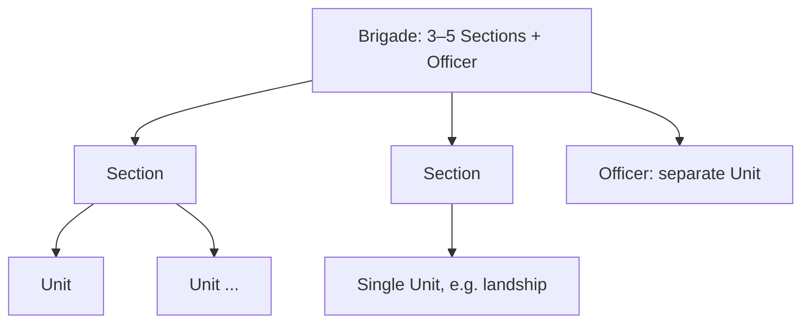

# Force hierarchy: Unit → Section → Brigade

## Summary
These names loosely follow WW1 conventions. A **Unit** is one fighter, a **Section** is a group of Units, and a **Brigade** is a group of Sections led by an Officer.

## Rules
- **HIE-001** (`decided`): A Unit MUST be a single fighting member.
- **HIE-002** (`decided`): A Section MUST be a group of one or more Units of the same type.
- **HIE-003** (`decided`): Section size MUST vary by type, down to a single Unit (e.g. a landship or large creature).
- **HIE-004** (`decided`): Section size MUST be derived from the Section's health. Losing health removes Units; healing restores them.
- **HIE-005** (`decided`): A Brigade MUST be formed with 3–5 Sections (P-BRG-01) plus an Officer. Afterwards it MAY drop below 3 (BRG-020).
- **HIE-006** (`decided`): An Officer MUST be a separate Unit, not part of a Section.
- **HIE-009** (`decided`): A hero, if present, MUST be a separate Unit that does not count towards the Section limit (HER-015).
- **HIE-010** (`decided`): Unit count MUST be health rounded **up**, so a Section with any health left shows at least 1 Unit.
- **HIE-007** (`decided`): Commands are given to Sections, not individual Units (see [[commands]]).
- **HIE-008** (`proposed`): Damage to a single-Unit Section SHOULD be shown on the model itself (smoke, limping, plates falling off).

## Parameters
| ID | Name | Status |
|---|---|---|
| P-HIE-01 | Max Units per Section, by type | open |
| P-HIE-02 | Health per Unit, by type | open |

## Edge cases
- A Section whose health falls to 0 is destroyed.
- Rounding: how health maps to whole Units (Q-HIE-01).

## Open questions
- Q-HIE-01 (answered → HIE-010): Round up.
