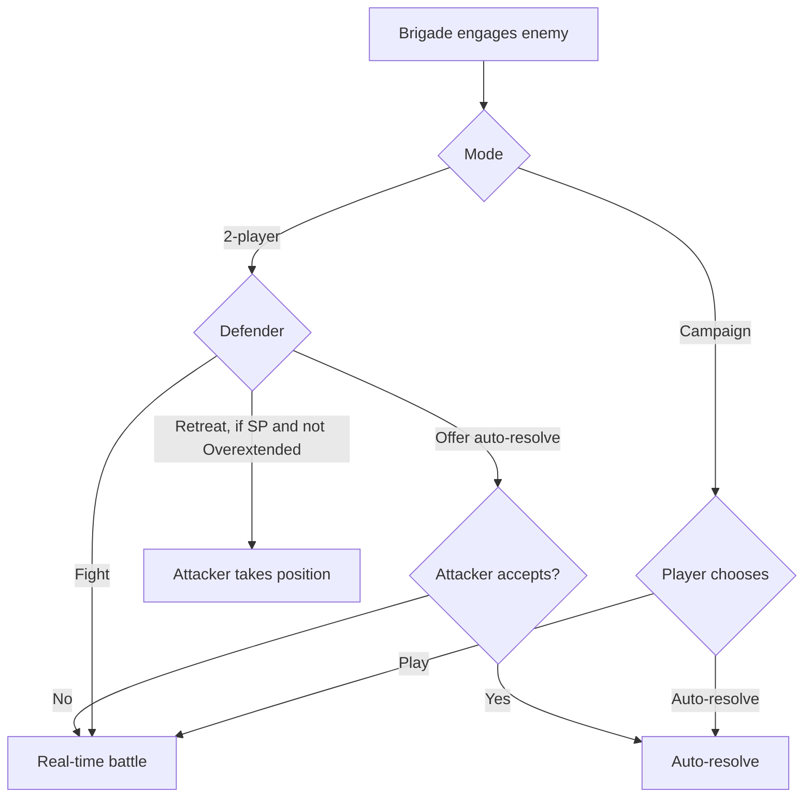

# Battle initiation

## Summary
A battle starts when a Brigade moves into contact with an enemy. Depending on the mode, the battle is either played in real time or auto-resolved.

## Rules
- **BIN-001** (`decided`): A battle MUST start when a Brigade engages an enemy Brigade or attacks a defended location.
- **BIN-002** (`decided`): The supply state of each Brigade MUST be fixed when the battle starts (see [[supply]]).
- **BIN-003** (`decided`): Auto-resolve MUST always be available in the campaign.
- **BIN-004** (`decided`): In 2-player mode, auto-resolve MUST only happen if both players agree.
- **BIN-005** (`decided`): In 2-player mode, the **defender** picks one of:
  1. **Fight**: play the battle in real time.
  2. **Retreat**: only if the Brigade has enough SP to move one space (P-BIN-01). The attacker takes the position, and the retreating Brigade takes a morale hit (P-BIN-02).
  3. **Offer auto-resolve**: the attacker accepts or insists on fighting.
- **BIN-006** (`decided`): An Overextended Brigade MUST NOT be able to retreat.
- **BIN-010** (`decided`): The attacker MAY likewise choose one friendly Brigade adjacent to the attacking Brigade to join as reinforcements.
- **BIN-009** (`decided`): The defender MAY choose one friendly Brigade **adjacent to the defending Brigade** to join the battle as reinforcements (max 2 Brigades per side, DEP-005).
- **BIN-011** (`decided`, DEC-115): Interim rule until Q-BIN-05 is answered: when a Brigade makes contact next to several enemy Brigades, the defender MUST be the enemy Brigade with the lowest id.
- **BIN-007** (`proposed`): Battles between AI Factions SHOULD always be auto-resolved.
- **BIN-008** (`proposed`): Auto-resolve SHOULD use a single combat formula, which also serves as the balance reference.

## Parameters
| ID | Name | Status |
|---|---|---|
| P-BIN-01 | Retreat SP cost | proposed |
| P-BIN-02 | Retreat morale penalty | proposed |

## Open questions
- Q-BIN-01 (deferred → working session): Auto-resolve formula and its inputs. To be designed in a dedicated session once Brigades and values exist.
- Q-BIN-05: When a Brigade makes contact next to several enemy Brigades, which one defends? Decide properly here; BIN-011 (lowest id) is an interim rule (DEC-115).
- Q-BIN-06: Can a Brigade that is already in a pending battle be drawn into a second battle (for example as reinforcements under BIN-009 or BIN-010, or by another Brigade's contact)? Linked to Q-BIN-01 and TRN-037 (DEC-115).
- Q-BIN-02 (answered → BIN-005, BIN-006): Defender chooses Fight / Retreat / Offer auto-resolve.
- Q-BIN-03 (answered → BIN-009): The defender picks one adjacent friendly Brigade to join.
- Q-BIN-04 (answered → BIN-010): Yes, the same as the defender.
