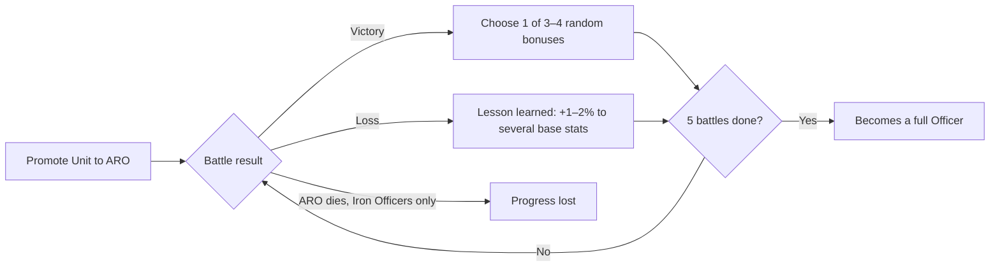

# Acting Ranking Officer (ARO) progression

## Summary
Any Unit can be promoted to **Acting Ranking Officer (ARO)**. Over 5 battles, each victory earns a bonus chosen from random options and each loss earns a small stacking "lesson learned" stat bonus. AROs are slower to get going than ready-made officers but can be tailored.

## Rules
- **ARO-001** (`decided`): The player MUST always be able to promote a Unit to ARO.
- **ARO-002** (`decided`): An ARO MUST start with basic stats and no bonuses.
- **ARO-003** (`decided`): An ARO MUST serve for 5 battles (P-ARO-01) before becoming a full Officer.
- **ARO-004** (`decided`): After each **victory**, the player MUST choose one bonus from 3–4 randomly offered options (P-ARO-02).
- **ARO-005** (`decided`): After each **loss**, the ARO MUST gain a "lesson learned" bonus of +1–2% (P-ARO-03) to several base stats (e.g. HP, accuracy, defence). It stacks.
- **ARO-006** (`decided`): Harder victories MUST give a higher chance that upgraded bonuses are among the options (P-ARO-04). Difficulty MUST be the pre-battle strength ratio from the auto-resolve calculator, which is worked out before every battle anyway. **Blocked by Q-BIN-01** (auto-resolve formula).
- **ARO-007** (`decided`): Auto-resolved battles MUST count towards the 5 battles but MUST NEVER offer upgraded bonuses.
- **ARO-008** (`decided`): The 3-slot limit and upgrade/replace rules apply (OFF-005, OFF-006).
- **ARO-009** (`decided`): With Iron Officers on, an ARO who dies MUST be permanently dead and their progress lost. In standard mode, an ARO who falls MUST be wounded like any officer (OFF-010) and keeps their progress.
- **ARO-010** (`decided`): Design intent: the limits are that it takes 5 battles to get up to speed, bonus options are random, and slots are limited.

### Promoting veterans
- **ARO-014** (`decided`): There MUST be no extra limit on creating AROs. The slow start (5 battles to develop) is enough of a cost.
- **ARO-013** (`decided`): "Promoting a Unit" MUST be flavour only. Functionally, it creates a new officer for free, with no effect on any existing Section.
- ~~ARO-011~~, ~~ARO-012~~: withdrawn. Promotion doesn't take a real Unit, so veteran promotion doesn't apply (DEC-051).

## Parameters
| ID | Name | Value | Status |
|---|---|---|---|
| P-ARO-01 | Battles as ARO | 5 | decided |
| P-ARO-02 | Bonus options per victory | 3–4 | decided |
| P-ARO-03 | Lesson learned per loss | +1–2% to several stats | decided |
| P-ARO-04 | Upgraded-bonus chance by difficulty | – | open |

## Open questions
- Q-ARO-01 (answered → ARO-006): The auto-resolve strength ratio.
- Q-ARO-02: Which base stats does "lesson learned" affect, exactly?
- Q-ARO-03: The bonus pool and what an "upgraded" bonus is.
- Q-ARO-04 (answered → ARO-013): Free; it's flavour that creates a new officer.
- Q-ARO-05 (answered → ARO-009): Iron Officers: dies and progress is lost. Standard mode: wounded and recovers.
