# Delivery pipeline and agents

## Summary
An AI-assisted delivery pipeline. Design decisions in this vault are turned into GitHub Issues by agents, built on story branches, reviewed automatically, and merged by Alex at the Feature level. Every piece of work traces back to a rule ID.

```mermaid
flowchart LR
    D[Design session<br/>Alex + Claude] --> V[docs/ vault<br/>rule IDs]
    V --> S[Design Steward<br/>spec checks]
    S --> P[Planner<br/>Features + order]
    P -->|Alex approves| T[Ticket Writer<br/>Stories + criteria]
    T --> G[GitHub Issues<br/>+ Project board]
    G --> DEV[Developer agent<br/>story branch + PR]
    DEV --> R[Reviewer agent<br/>auto on PR]
    R --> CI[CI tests]
    CI --> F[Feature branch]
    F -->|Alex merges| M[main + milestone]
    M --> PT[Playtest<br/>Alex, Dad, Uncle]
    PT --> D
```

## Traceability
`Rule (e.g. SUP-006) → Story issue → story branch/PR → test named after the rule → playtest notes → new decisions`

## Rules
### Repository and tracker
- **DLV-001** (`decided`): The project MUST live in a **public GitHub repository** (to show in interviews and on Alex's portfolio).
- **DLV-002** (`decided`): Work MUST be tracked in **GitHub Issues and GitHub Projects** (free). Agents SHOULD set these up through the GitHub API/CLI.
- **DLV-003** (`decided`): The workflow MUST be **simple Kanban**, not SAFe.
- **DLV-004** (`decided`): Work MUST be split into **Features** and **Stories**. Each completed Feature MUST close a **milestone**.
- **DLV-005** (`proposed`): Board columns: Backlog → Ready → In progress → In review → Done.
- **DLV-006** (`proposed`): A Feature is a parent issue with the `feature` label and a milestone; Stories are sub-issues with the `story` label.

### Branching and merging
- **DLV-007** (`decided`): Each Feature MUST have a **feature branch**. Alex MUST merge the feature branch into `main` himself, only when completely happy with it.
- **DLV-008** (`proposed`): Each Story SHOULD have its own short-lived branch, merged into the feature branch by PR after automatic review and passing tests.
- **DLV-009** (`decided`): The Design Steward MAY commit doc fixes directly, but only fixes Alex has agreed in conversation.

### Ready and Done
- **DLV-010** (`proposed`): **Definition of Ready**: a Story cites its rule IDs and parameter IDs, has Given/When/Then acceptance criteria, has no blocking open questions, and fits in one PR.
- **DLV-011** (`proposed`): **Definition of Done**: the acceptance criteria pass as automated tests named after the rules; the Reviewer has approved; CI is green; docs are updated if behaviour changed.

### Architecture
- **DLV-012** (`decided`): The game MUST be split into a **simulation core in plain C#** (no Unity dependency: hex map, supply, turns, Cards, morale, auto-resolve) and a **Unity presentation layer** (rendering, input, third-person battles).
- **DLV-013** (`decided`): Every player action MUST be a **command** applied to the game state, so actions can later be sent over the network or saved (multiplayer-ready, TEC-008).
- **DLV-014** (`proposed`): Tunable values from [[parameters]] SHOULD live in data files, not code.

## Agents
| Agent | Does | May touch | Trigger |
|---|---|---|---|
| Design Steward | Checks docs (links, IDs, statuses, contradictions); regenerates registers | `docs/` only | On demand + automatic check on PRs that touch `docs/` (proposed) |
| Planner | Turns decided rules into Features in order, with dependencies; prototypes first | Issues (read docs) | On demand, after design sessions |
| Ticket Writer | Writes Stories with rule IDs, acceptance criteria and parameters; marks blocked ones | Issues (read docs) | On demand, per Feature |
| Developer | Implements one Story per branch, with tests; cites rule IDs in commits | Code, its own branch | On demand, per Story |
| Reviewer | Reviews each PR against its Story's rules and the architecture | PR comments only | **Automatic on every PR** (proposed) |
| CI | Runs core tests and doc checks | – | **Automatic on every push / PR** |
| Balance agent | Runs auto-resolve simulations to tune numbers | Proposals only | Later, on demand |

- **DLV-015** (`decided`): Agents MUST be defined as Claude Code subagents in the repo (`.claude/agents/*.md`), each with its own instructions, tools and limits.
- **DLV-016** (`decided`): No agent MAY merge into `main`.

## Open questions
- Q-DLV-01: Trigger for each agent: on demand vs automated (Reviewer and CI automated is proposed). Under discussion.
- Q-DLV-02: Running agents automatically in GitHub Actions needs an Anthropic API key, with usage costs. Is that acceptable, or should everything stay on-demand from Claude Code at first?
