# Delivery pipeline and agents

## Summary
An AI-assisted delivery pipeline. Design decisions in this vault are turned into GitHub Issues by agents, built on story branches, reviewed automatically, and merged by Alex at the Feature level. Every piece of work traces back to a rule ID.

```mermaid
flowchart LR
    D[Design session<br/>Alex + Claude] --> V[docs/ vault<br/>rule IDs]
    V --> S[Design Steward<br/>spec checks]
    S --> P[Planner<br/>Features + order]
    P -->|Alex approves| T[Ticket Writer<br/>Stories + criteria]
    T --> G[GitHub Issues<br/>+ Project board]
    G --> DEV[Developer agent<br/>story branch + PR]
    DEV --> R[Reviewer agent<br/>auto on PR]
    R --> CI[CI tests]
    CI --> F[Feature branch]
    F -->|Alex merges| M[main + milestone]
    M --> PT[Playtest<br/>Alex, Dad, Uncle]
    PT --> D
```

## Traceability
`Rule (e.g. SUP-006) → Story issue (e.g. SP2-38) → story branch/PR → test named after the rule → playtest notes → new decisions`

## Rules
### Repository and tracker
- **DLV-001** (`decided`): The project MUST live in a **public GitHub repository** (to show in interviews and on Alex's portfolio).
- **DLV-002** (`decided`): Work MUST be tracked in **GitHub Issues and GitHub Projects** (free). Agents SHOULD set these up through the GitHub API/CLI.
- **DLV-003** (`decided`): The workflow MUST be **simple Kanban**, not SAFe.
- **DLV-004** (`decided`): Work MUST be split into **Features** and **Stories**. Each completed Feature MUST close a **milestone**.
- **DLV-005** (`decided`, confirmed by DEC-085): Board columns: Backlog → Ready → In progress → In review → Done.
- **DLV-006** (`decided`, confirmed by DEC-088): A Feature is a parent issue with the `feature` label and a milestone; Stories are sub-issues with the `story` label.

### Branching and merging
- **DLV-007** (`decided`): Each Feature MUST have a **feature branch**. Alex MUST merge the feature branch into `main` himself, only when completely happy with it.
- **DLV-008** (`decided`, confirmed by DEC-088): Each Story SHOULD have its own short-lived branch, merged into the feature branch by PR after automatic review and passing tests.
- **DLV-019** (`decided`, DEC-098): Each Feature MUST have a three-character code that does not reuse a rule-ID prefix, e.g. `SP2` for Spike 2. A Story's ID is `<code>-<issue number>`, e.g. `SP2-38`, so it can't be mistaken for a PR number. Feature issue titles start with the code (`SP2: …`), Story issue titles and Story PR titles start with the Story ID (`SP2-38: …`), and Story branches are `story/<story-id>-<short-name>` (`story/SP2-38-default-behaviour`). PR bodies still say `Closes #38` so GitHub links the issue.
- **DLV-009** (`decided`, revised by DEC-084): Agents MAY change the docs directly when Alex has already discussed the change. Anything completely new MUST be raised with Alex first.

### Ready and Done
- **DLV-010** (`decided`, confirmed by DEC-088): **Definition of Ready**: a Story cites its rule IDs and parameter IDs, has Given/When/Then acceptance criteria, has no blocking open questions, and fits in one PR.
- **DLV-011** (`decided`, confirmed by DEC-088): **Definition of Done**: the acceptance criteria pass as automated tests named after the rules; the Reviewer has approved; CI is green; docs are updated if behaviour changed.

### Architecture
- **DLV-012** (`decided`): The game MUST be split into a **simulation core in plain C#** (no Unity dependency: hex map, supply, turns, Cards, morale, auto-resolve) and a **Unity presentation layer** (rendering, input, third-person battles).
- **DLV-013** (`decided`): Every player action MUST be a **command** applied to the game state, so actions can later be sent over the network or saved (multiplayer-ready, TEC-008).
- **DLV-014** (`decided`, DEC-097): Tunable values from [[parameters]] MUST live in data files and be named by parameter ID, not hard-coded. A missing value MUST be an error, not a default in code.

## Agents
| Agent | Does | May touch | Trigger |
|---|---|---|---|
| Design Steward | Checks docs (links, IDs, statuses, contradictions); regenerates registers | `docs/` only | On demand. The scripted doc check also runs in CI on every PR and every push to `main` |
| Planner | Turns decided rules into Features in order, with dependencies; prototypes first | Issues (read docs) | On demand, after design sessions |
| Ticket Writer | Writes Stories with rule IDs, acceptance criteria and parameters; marks blocked ones | Issues (read docs) | On demand, per Feature |
| Developer | Implements one Story per branch, with tests; cites rule IDs in commits | Code, its own branch | On demand, per Story |
| Reviewer | Reviews each PR against its Story's rules and the architecture | PR comments only | **Automatic on every PR** (proposed) |
| CI | Runs core tests and doc checks | – | **Automatic on every PR and every push to `main`** |
| Balance agent | Runs auto-resolve simulations to tune numbers | Proposals only | Later, on demand |

- **DLV-015** (`decided`): Agents MUST be defined as Claude Code subagents in the repo (`.claude/agents/*.md`), each with its own instructions, tools and limits.
- **DLV-016** (`decided`): No agent MAY merge into `main`.
- **DLV-017** (`decided`, DEC-089): Agents MAY merge PRs into any branch other than `main`, e.g. a Story PR into its Feature branch once it meets the Definition of Done (DLV-011).
- **DLV-018** (`decided`, DEC-090): Each agent MUST set its model in its definition's `model:` frontmatter. The Planner and Reviewer use **Opus**; the Ticket Writer, Developer and Design Steward use **Sonnet**.

## Current setup
What exists in the repository today:
- **Agents:** `.claude/agents/` defines `design-steward`, `planner`, `ticket-writer`, `developer` and `reviewer` (DLV-015). Each sets its model (DLV-018): `planner` and `reviewer` use Opus; `ticket-writer`, `developer` and `design-steward` use Sonnet. The Balance agent comes later. All agents run on demand from Claude Code until Q-DLV-01 and Q-DLV-02 are answered.
- **Project instructions:** `CLAUDE.md` at the repo root.
- **Doc check:** `scripts/check_docs.py` checks frontmatter, links, rule IDs and statuses, duplicate and undefined IDs, and stale registers. Its tests are in `scripts/test_check_docs.py`.
- **CI:** `.github/workflows/ci.yml` runs the doc tests and the doc check (the `Doc checks` job) on every PR and on every push to `main`. Pushes to other branches don't trigger it, so a branch with an open PR is checked once, not twice. The `Campaign core tests` job runs `dotnet test` on the production core in `src/` (TEC-016). The `Core tests` job runs the Spike 1 prototype tests.
- **Branch protection on `main`** (enforces DLV-007 and DLV-016): changes go through a PR, the `Doc checks` job must pass, and force-pushes and deletion are blocked. This applies to admins too. No approval count is required, because Alex can't approve his own PRs.
- **Agent permissions:** `.claude/settings.json` blocks pushes to `main`, and runs a hook (`.claude/hooks/block_main_merge.py`) before every shell command. The hook lets agents merge PRs into other branches (DLV-017) but blocks:
  - any merge into `main` (DLV-016)
  - any merge whose target branch it can't find
  - any command that mentions merging a PR but can't be read as a merge
  - merges through the raw GitHub API

  Its tests are in `scripts/test_block_main_merge.py`. Agents use Alex's GitHub account, so GitHub alone can't tell them apart from Alex.
- **Repository:** merged branches are deleted automatically.
- **Project board:** "@Helligon's Weird War", user project **#1** (https://github.com/users/Helligon/projects/1), linked to the repo. Its Status columns follow DLV-005.

## Open questions
- Q-DLV-01: Trigger for each agent: on demand vs automated (Reviewer and CI automated is proposed). Under discussion.
- Q-DLV-02: Running agents automatically in GitHub Actions needs an Anthropic API key, with usage costs. Is that acceptable, or should everything stay on-demand from Claude Code at first?
